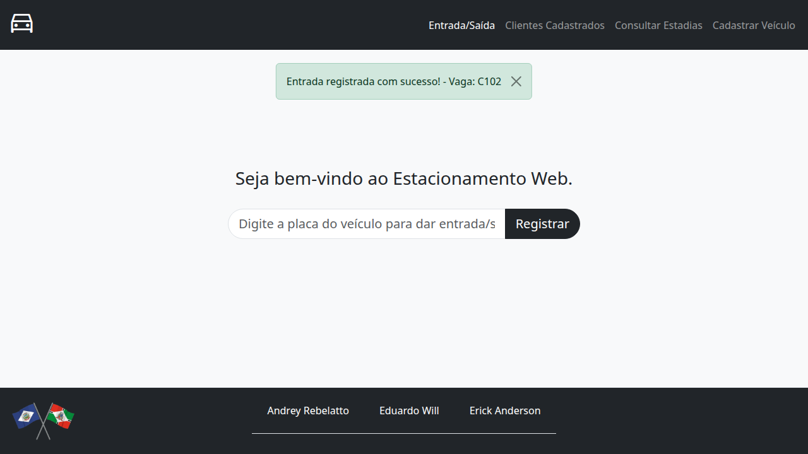
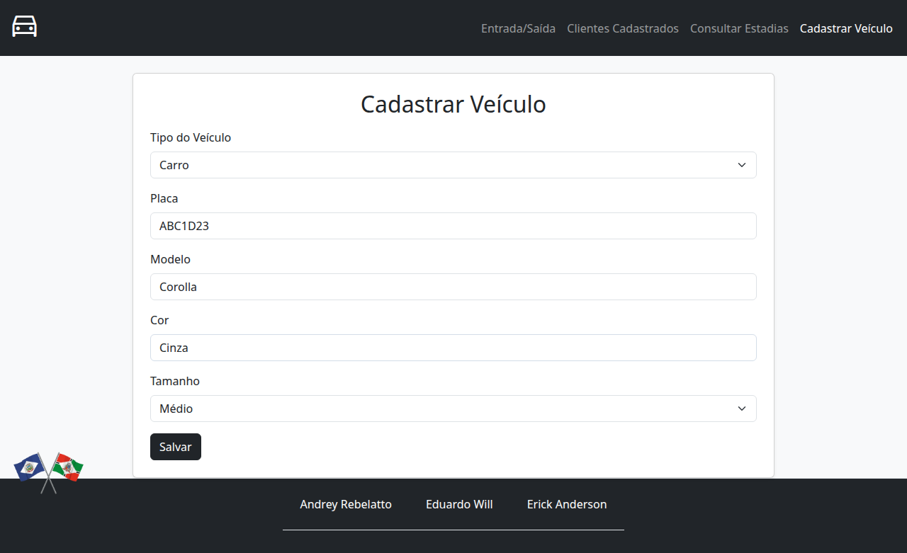
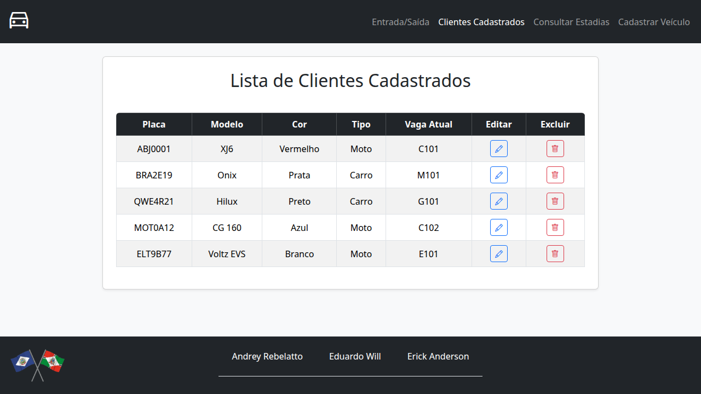
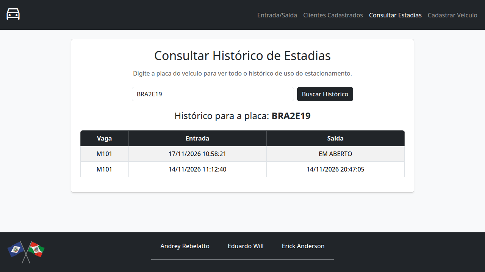
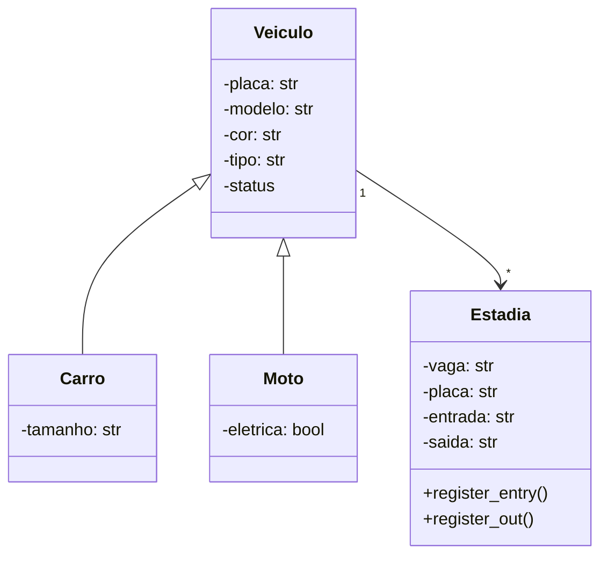

# 🚗 Estacionamento Web


Sistema web para gerenciar um estacionamento: cadastro de veículos, registro de entrada e saída com alocação automática de vagas e histórico de estadias.

Projeto desenvolvido para a disciplina de **Algoritmos e Programação de Computadores II (APC II)** da **Univille**. A primeira versão rodava no terminal e foi refatorada para uma aplicação web com **Flask**.



## Sumário

- [Funcionalidades](#funcionalidades)
- [Telas](#telas)
- [Como executar](#como-executar)
- [Estrutura do projeto](#estrutura-do-projeto)
- [Modelagem](#modelagem)
- [Equipe](#equipe)

## Funcionalidades

- **Entrada e saída por placa:** basta digitar a placa. O sistema registra a entrada se o veículo não estiver no pátio e a saída se ele já estiver estacionado.
- **Alocação automática de vagas:** cada veículo vai para a primeira vaga livre compatível com o seu tipo.
- **Cadastro de veículos:** carros (porte médio ou grande) e motos (a combustão ou elétricas). Uma placa sem cadastro é levada direto para o formulário de cadastro.
- **Gestão de clientes:** lista os veículos cadastrados e permite editar ou excluir cada um.
- **Histórico de estadias:** consulta de todas as entradas e saídas de uma placa.

### Tipos de vaga

O banco é criado automaticamente na primeira execução, com 25 vagas de cada tipo (`101` a `125`):

| Prefixo | Vaga para           | Exemplo |
|---------|---------------------|---------|
| `M`     | Carro de porte médio  | `M101`  |
| `G`     | Carro de porte grande | `G101`  |
| `C`     | Moto a combustão    | `C101`  |
| `E`     | Moto elétrica       | `E101`  |

## Telas

| Cadastro de veículo | Clientes cadastrados |
|:---:|:---:|
|  |  |
| **Histórico de estadias** | **Entrada/Saída** |
|  |  |

## Como executar

**Pré-requisito:** Python 3.10 ou superior.

```bash
# 1. Clone o repositório
git clone https://github.com/ads-erick/sistema-estacionamento.git
cd sistema-estacionamento

# 2. Crie e ative um ambiente virtual
python -m venv venv
source venv/bin/activate      # Linux/macOS
venv\Scripts\activate         # Windows

# 3. Instale as dependências
pip install -r requirements.txt

# 4. Inicie a aplicação
python app.py
```

Depois, acesse **http://127.0.0.1:5000** no navegador.

> [!NOTE]
> O banco SQLite (`estacionamento.db`) fica na raiz do projeto. Se ele não existir, o sistema cria as tabelas e as vagas automaticamente ao iniciar.

## Estrutura do projeto

```
sistema-estacionamento/
├── app.py                   # Rotas Flask (camada web)
├── controller.py            # Regras de negócio (entrada, saída, CRUD de veículos)
├── classes/                 # Classes de domínio (POO)
│   ├── Veiculo.py
│   ├── Carro.py
│   ├── Moto.py
│   └── Estadia.py
├── repository/              # Acesso a dados com SQLAlchemy
│   ├── database.py          # Engine, modelos ORM e criação das vagas
│   └── estacionamento_repo.py
├── templates/               # Páginas HTML (Jinja2 + Bootstrap)
├── static/assets/           # Ícones e imagens
├── docs/screenshots/        # Capturas de tela do README
└── old/                     # Versão anterior, feita para terminal
```

### Rotas

| Rota        | Método      | Descrição                                     |
|-------------|-------------|-----------------------------------------------|
| `/`         | GET, POST   | Registro de entrada/saída pela placa          |
| `/cadastro` | GET, POST   | Cadastro de veículo                           |
| `/clientes` | GET, POST   | Lista, edição e exclusão de veículos          |
| `/estadias` | GET, POST   | Histórico de estadias de uma placa            |

## Modelagem



<details>
<summary><strong>Detalhes das classes</strong></summary>

#### Veiculo

| Propriedade | Tipo   | Descrição                         | Visibilidade |
|-------------|--------|-----------------------------------|--------------|
| `placa`     | String | Chave primária do veículo         | Private      |
| `modelo`    | String | Modelo do veículo                 | Private      |
| `cor`       | String | Cor do veículo                    | Private      |
| `tipo`      | String | Tipo do veículo (`C` carro, `M` moto) | Private  |
| `status`    | —      | Situação do veículo               | Private      |

#### Carro (herda de `Veiculo`)

| Propriedade | Tipo   | Descrição                         | Visibilidade |
|-------------|--------|-----------------------------------|--------------|
| `tamanho`   | String | Porte do veículo (`M` ou `G`)     | Private      |

#### Moto (herda de `Veiculo`)

| Propriedade | Tipo    | Descrição                                    | Visibilidade |
|-------------|---------|----------------------------------------------|--------------|
| `eletrica`  | Boolean | A moto é elétrica? (`True` sim, `False` não) | Private      |

#### Estadia

| Propriedade | Tipo   | Descrição                          | Visibilidade |
|-------------|--------|------------------------------------|--------------|
| `vaga`      | String | Vaga utilizada                     | Private      |
| `placa`     | String | Placa do veículo que usou a vaga   | Private      |
| `entrada`   | String | Data e hora da entrada             | Private      |
| `saida`     | String | Data e hora da saída               | Private      |

</details>

## Equipe

- Andrey Rebelatto
- Eduardo Will
- Erick Anderson
